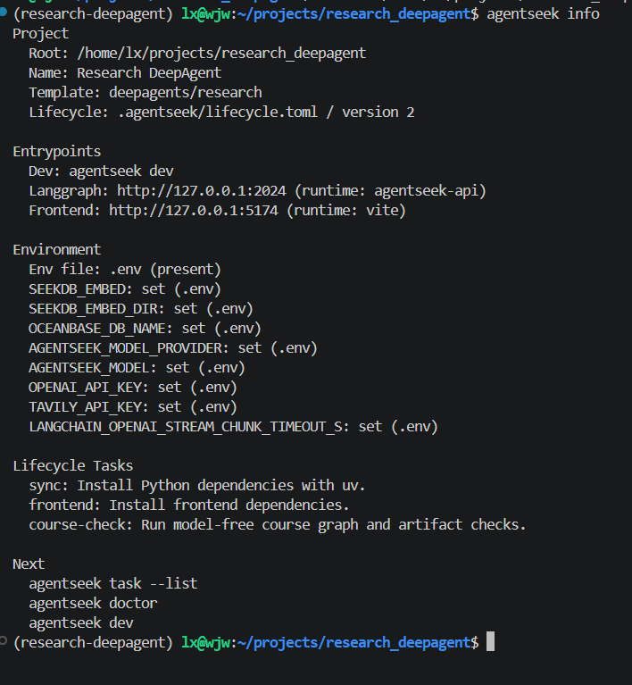
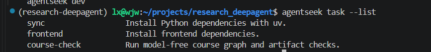
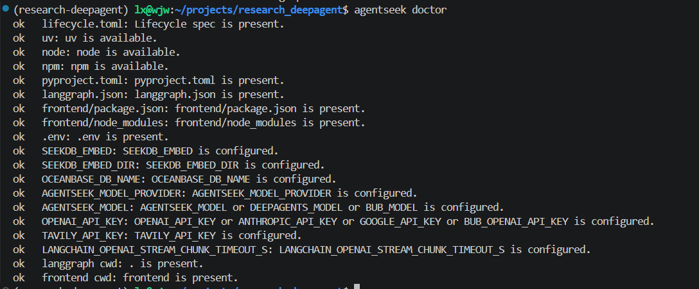
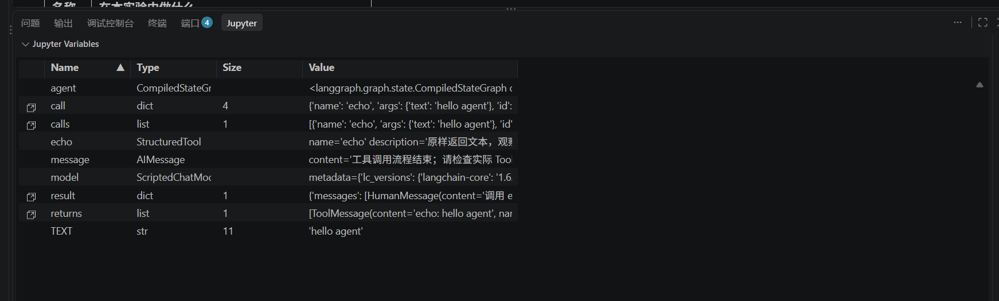
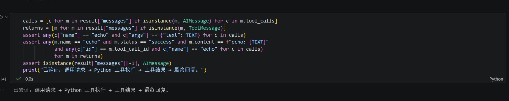
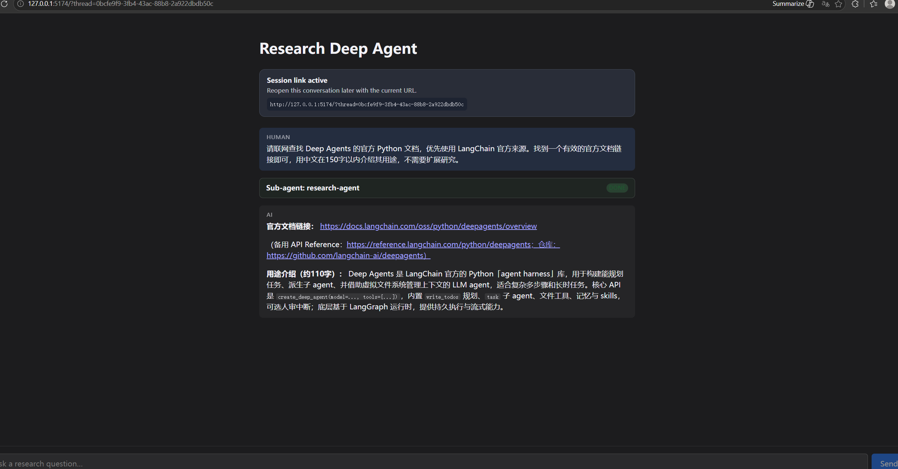

# Task 0：环境准备与第一次工具调用

学习日期：2026-10-12 至 2026-10-13。

## 1. 我验证了什么

这次任务是安装 AgentSeek、运行 offline 最小工具 Notebook、生成主模板，再查看 `info`、`task` 和 `doctor`。我之前只了解过 Agent 的概念，这次先把项目跑起来，再通过一个小实验看工具到底是怎么被调用的。

我按准备篇创建了 `deepagents/research` 应用，项目放在 `/home/lx/projects/research_deepagent`。课程 Notebook 放在 `/home/lx/projects/deepagents-course-materials`，这里记录学习过程和运行结果。

## 2. 我改了什么

一开始我在 Windows 上安装环境，后来为了使用嵌入式 SeekDB，把项目迁移到了 WSL2 Ubuntu。模型接入用了我已有的阿里云百炼北京地域 API Key，通过 OpenAI 兼容接口调用。

Notebook 实验中，我复制了一份 `task0-minimal-tool.ipynb`，只改了传给 `echo` 工具的文本：

```diff
- TEXT = "hello course"
+ TEXT = "hello agent"
```

工具函数保持原样：

```python
@tool
def echo(text: str) -> str:
    """原样返回文本，观察一次工具调用。"""
    return f"echo: {text}"
```

修改前，工具返回 `echo: hello course`。我预计把输入改成 `hello agent` 后，工具会返回 `echo: hello agent`，调用 ID 和成功状态保持一致。重新运行后，结果和预期相符。

## 3. 实际结果与证据

### AgentSeek 环境

我安装的 AgentSeek CLI 是 `0.1.6`，已经创建研究模板并安装了前后端依赖。`doctor` 检查通过，`doctor --live` 也能访问前后端服务。[命令记录](../evidence/task0/agentseek-records.txt) 保存了当时的输出。

研究应用用的是 DeepAgents `0.7.8`，课程 Notebook 用的是 `0.7.22`，各自使用独立的虚拟环境。

运行 `agentseek info` 后，可以看到项目是 `deepagents/research`，后端入口在 2024 端口，前端入口在 5174 端口，`.env` 也已存在。



`agentseek task --list` 列出了 `sync`、`frontend` 和 `course-check`。我用前两项安装了后端与前端依赖；这张图展示的是任务列表。



最后运行 `agentseek doctor`，工具、项目文件、前端依赖和必需环境变量的检查结果都是 `ok`。



### Offline：最小工具实验

执行命令：

```bash
uv sync --project notebooks --locked
uv run --project notebooks --locked python -m course_notebooks.run template --mode offline
```

实际终端结果：

```text
template: passed (offline)
```

运行结果保存在 [report.json](../evidence/task0/baseline/report.json) 中：Python `3.12.3`、`offline` 模式、`template` 实验通过。完整输出也保存在 [Markdown](../evidence/task0/baseline/template.md) 和 [Notebook](../evidence/task0/baseline/template.ipynb) 中。

```text
human  调用 echo，原样返回 hello course
ai
  请求工具: echo 参数: {'text': 'hello course'} 调用 ID: template-echo
tool echo echo: hello course
  对应调用 ID: template-echo 执行状态: success
ai  工具调用流程结束；请检查实际 ToolMessage。

已验证：调用请求 → Python 工具执行 → 工具结果 → 最终回复。
```

这里的 `echo` 函数确实执行了，工具结果通过调用 ID 对应回请求。offline 模式里的模型回复是预先安排好的，所以这次观察的是工具执行流程，没有调用付费模型。

### 修改后的练习：完整运行与对照结果

修改后，我在 VS Code 中选择 `deepagents-course-notebooks (3.12.3)` 内核，点击“全部运行”。四个代码格按顺序执行，环境显示 `Linux x86_64`、Python `3.12.3`，模式为 `offline`。

我保存了 [练习副本](../evidence/task0/changed/task0-minimal-tool.ipynb) 和 [输出文本](../evidence/task0/changed/output.txt)，其中工具调用的结果是：

```text
human  调用 echo，原样返回 hello agent
ai
  请求工具: echo 参数: {'text': 'hello agent'} 调用 ID: template-echo
tool echo echo: hello agent
  对应调用 ID: template-echo 执行状态: success
ai  工具调用流程结束；请检查实际 ToolMessage。

已验证：调用请求 → Python 工具执行 → 工具结果 → 最终回复。
```

| 检查内容 | 修改前 | 修改后 |
| --- | --- | --- |
| 输入变量 `TEXT` | `hello course` | `hello agent` |
| 工具调用参数 `text` | `hello course` | `hello agent` |
| 实际工具返回 | `echo: hello course` | `echo: hello agent` |
| 调用与返回关联 ID | `template-echo` | `template-echo` |
| 工具状态与最终断言 | `success`，断言通过 | `success`，断言通过 |





对照原文件，代码只改了第 3 个单元格的 `TEXT`。[保存结果的检查记录](../evidence/task0/changed/verification.json) 也放在附件中。

这次输入从 `hello course` 变成了 `hello agent`，工具返回也跟着改变，而调用 ID 和成功状态保持一致。我能沿着参数和返回值看清这个变化，最后的断言也全部通过了。

### Live：第一次跑通研究应用

研究应用接入阿里云百炼北京地域的 `qwen3.8-flash`，配置如下：

```ini
AGENTSEEK_MODEL_PROVIDER=openai
AGENTSEEK_MODEL=qwen3.8-flash
OPENAI_API_BASE=https://dashscope.aliyuncs.com/compatible-mode/v1
AGENTSEEK_PARALLEL_TOOL_CALLS=false
```

我让它联网查找 Deep Agents 官方 Python 文档，再用中文简要介绍用途。任务完成后，页面返回了官方文档链接和介绍。



这次运行记录在 LangSmith 的 `deepagents-course` 项目中，根 Trace 名称是 `LangGraph`，ID 为 `01a13089-ef5b-7e21-b5ca-29399e323225`，总耗时 `200.36s`。我还做了 [Trace 分析](../evidence/task0/trace-analysis.md)，看看时间花在了哪里。

### 查看 Trace

我用下面的命令查询这次运行：

```bash
langsmith trace get 01a13089-ef5b-7e21-b5ca-29399e323225 --project deepagents-course --include-metadata
```

[完整输出](../evidence/task0/trace-tree.txt) 已保存。下面只保留子流程和最慢调用的层级，省略了中间的 middleware 和其他调用：

```text
LangGraph (chain) [200.36s]
└── task (tool) [179.01s]
    └── general-purpose (chain) [179.00s]
        ├── ChatOpenAI (llm) [40.85s]       ← 最慢模型调用
        └── tavily_search (tool) [13.06s]  ← 最慢搜索工具调用
```

我从完整树中数到了 20 个 `llm`、18 个 `tool`、126 个 `chain`，合计 164 个 Run。18 个工具节点中有一个 `task` 包装层，实际业务工具是 17 次：5 次 `tavily_search`、8 次 `read_file`、4 次 `grep`。

看到这些记录后，我才更具体地理解了为什么一次研究请求会花几分钟：背后有多轮模型调用、搜索和文件读取。`task` 的约 179 秒已经包含整个子流程的时间，再加上里面各次调用的耗时就会重复计算。这次最慢的模型调用约 40.85 秒，最慢的搜索调用约 13.06 秒。

树形输出能看到名称、类型和耗时。要看完整的输入、输出和 Token 用量，还需要继续查询具体 Run；这些细节记录在分析附件里。

### 我第一次了解到 LangSmith 和 Tavily

LangSmith 和 Tavily 都是我这次学习才接触到的。我按照课程创建账户、配置 Key，跑起来以后才逐渐弄清它们各自负责什么：

| 服务 | 在我的项目中负责什么 | 我观察到的结果 |
| --- | --- | --- |
| 阿里云百炼 | 提供 `qwen3.8-flash` 模型，生成回答与工具调用请求 | 研究应用返回最终答案；模型调用记录为 `ChatOpenAI` |
| Tavily | 作为联网搜索工具的外部服务，为研究提供搜索结果 | Trace 中出现 5 次 `tavily_search` |
| LangSmith | 收集与查询应用的 Trace，帮助观察模型、工具和子流程的关系与耗时 | 我能查询到真实研究的完整运行树 |

我对 [Tavily](https://docs.tavily.com/documentation/about) 的理解是，它提供搜索 API，让 Agent 能获取网上的资料。[LangSmith](https://docs.langchain.com/langsmith/observability) 则记录运行过程，让我能查看模型调用了哪些工具、各步骤花了多久。

这次 Trace 里有 5 次 `tavily_search`，我才把搜索 API 的配置和实际运行联系起来。以前没听过这两个服务，现在至少知道它们在这个项目里怎么用，也能查到一次完整的运行记录。

## 4. 踩坑与解释

| 现象 | 我的处理与理解 |
| --- | --- |
| GitHub 下载超时 | 用 `git ls-remote` 检查连接。后来发现，之前在终端里设置的代理不会自动带到新终端，需要重新设置。 |
| Windows 上的嵌入式 SeekDB 启动失败 | 把项目迁移到 Ubuntu，重新安装 Linux 的 Python 和前端依赖。之前创建的项目文件仍然能用。 |
| 模型调用出现 `403 AllocationQuota.FreeTierOnly` | 免费额度耗尽，同时开启了仅使用免费额度的设置，任务中途停止。处理额度问题后才跑完研究。 |
| `source .env` 报错，接口地址带 `\r` | 把 `.env` 的换行从 CRLF 改成 LF，重新加载后，LangSmith CLI 就能正常查询了。 |
| `Address already in use` | 用 `ss` 查到旧后端还占着 2024 端口，结束旧进程后重新启动。 |
| 按 `--name research` 查不到 Trace | 去掉名称过滤后找到了 `LangGraph`，实际记录的名字和教程示例不同。 |
| 安装 Python 扩展等了很久 | 安装完成后，才在 VS Code 中选好课程的 Python 内核并运行 Notebook。具体卡住的原因还没查清。 |

## 5. 我的学习总结

这次花时间最多的地方是搭环境。GitHub 下载、WSL 代理、换行格式和端口占用都让我卡过。以前碰到这种情况，我容易直接重试；这次逐渐学会先看报错，确定卡在下载、启动还是接口调用，再处理对应的问题。

Notebook 的小实验让我对工具调用有了具体认识。把 `TEXT` 改成 `hello agent` 后，调用参数和工具返回都跟着改变，调用 ID 还能把请求和结果对应起来。我也知道了，offline 模型的回复是预先安排的，真正执行的是 Python 工具。

LangSmith 和 Tavily 是这次新认识的两个服务。前者让我看到了研究任务的运行过程，后者负责联网搜索。一个简短的问题，实际跑了约 200 秒，调用了 20 次模型和 17 次实际工具，这让我更容易理解之前为什么觉得 Agent 很耗 Token。

## 6. 下一步

下一阶段，我希望进一步理解真实模型如何选择工具，以及搜索结果和文件读取如何累积上下文。

## 参考来源

- [课程：准备篇（上）](https://datawhalechina.github.io/deepagents-in-action/chapters/pre01-agentseek-create/)
- [课程：准备篇（下）](https://datawhalechina.github.io/deepagents-in-action/chapters/pre02-agentseek-skills/)
- [Notebook 运行说明](https://github.com/datawhalechina/deepagents-in-action/blob/f93fe0a8be843eae77efaf85448035ddc54ff7ea/notebooks/README.md)
- [最小工具实验源文件](https://github.com/datawhalechina/deepagents-in-action/blob/f93fe0a8be843eae77efaf85448035ddc54ff7ea/notebooks/_template/01-minimal-tool.ipynb)
- [LangSmith Observability 官方说明](https://docs.langchain.com/langsmith/observability)
- [Tavily 官方介绍](https://docs.tavily.com/documentation/about)

