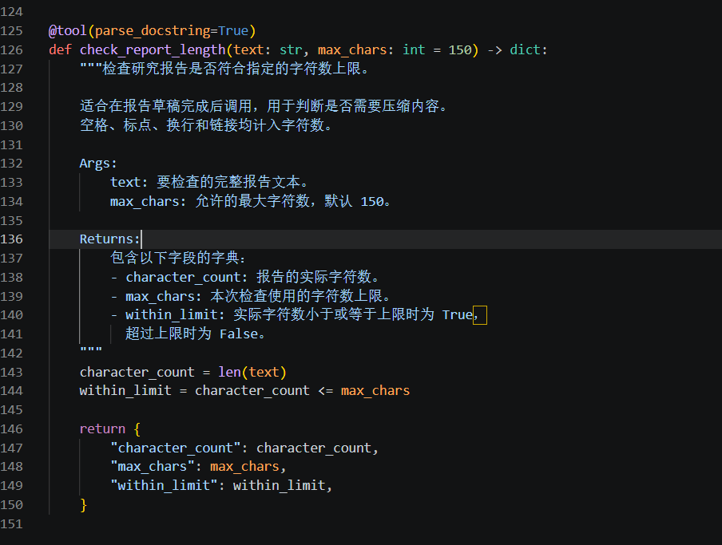
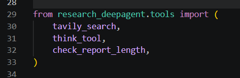
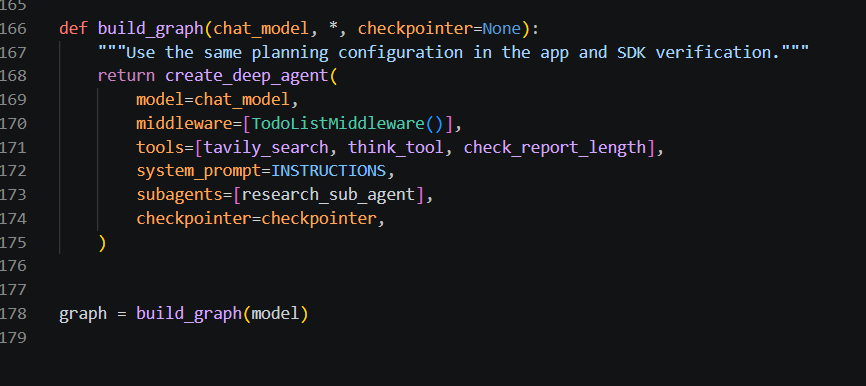
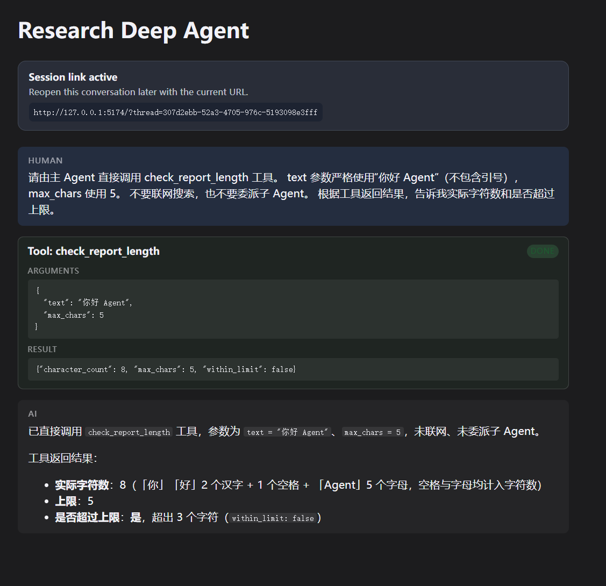
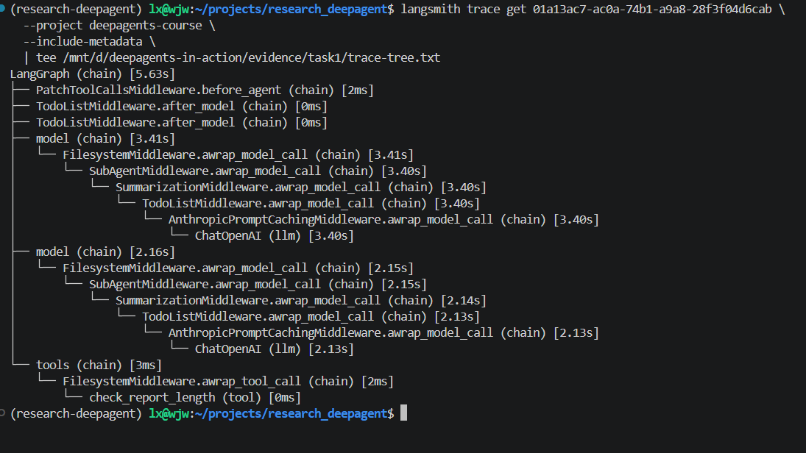

# Task 1：给研究助手添加一个自己的工具

学习日期：2026-10-13 至 2026-10-14。

## 1. 这次想弄明白什么

读完第 1、2 章后，我对三层架构有了初步理解：LangGraph 提供执行和状态管理，LangChain 提供模型、工具接口和调用循环，Deep Agents 在这些基础上装配文件操作、子 Agent 和上下文管理等能力。

这次我继续使用 Task 0 创建的 `deepagents/research`，给现有主 Agent 添加一个检查报告长度的工具。项目仍在 WSL Ubuntu 的 `/home/lx/projects/research_deepagent` 中，依赖沿用 Task 0 的环境，研究应用当时记录的 DeepAgents 版本是 `0.7.8`。

我想通过这次修改弄清楚：普通 Python 函数如何成为工具，模型怎样知道它的用途，以及工具返回后，模型怎样继续回答。

## 2. 从看懂代码到写出工具

看教程时，我能看懂函数，但自己写的时候不知道处理逻辑该从哪里开始。和学习助手讨论后，我先把需求拆成输入、处理、返回，再翻译成 Python。

我选的需求是检查研究简报的长度。之前用研究助手时，我提过“150 字以内”的要求，这次就把长度检查交给 Python 来做。

| 部分 | 我的设计 |
| --- | --- |
| 输入 | 报告文本 `text` 和字符数上限 `max_chars`，默认上限为 150 |
| 处理 | 用 `len(text)` 计算字符数，再与上限比较 |
| 返回 | 实际字符数、检查上限、是否符合上限 |

这里统计的是 Python 字符串的长度，空格、标点、换行和链接也计入，不是模型的 Token 数。

我最开始把判断写成了 `character_count > max_chars`。后来才意识到，这个条件表达的是“是否超标”，而我命名的 `within_limit` 表达的是“是否符合上限”。所以最终用了 `<=`，刚好等于上限也算符合要求。

## 3. 我改了哪些代码

### 在 tools.py 中定义工具

我在 `src/research_deepagent/tools.py` 中添加了下面的函数，沿用原有工具的 `@tool(parse_docstring=True)` 写法。文件顶部已有 `tool` 导入。

```python
@tool(parse_docstring=True)
def check_report_length(text: str, max_chars: int = 150) -> dict:
    """检查研究报告是否符合指定的字符数上限。

    适合在报告草稿完成后调用，用于判断是否需要压缩内容。
    空格、标点、换行和链接均计入字符数。

    Args:
        text: 要检查的完整报告文本。
        max_chars: 允许的最大字符数，默认 150。

    Returns:
        包含以下字段的字典：
        - character_count: 报告的实际字符数。
        - max_chars: 本次检查使用的字符数上限。
        - within_limit: 实际字符数小于或等于上限时为 True，
          超过上限时为 False。
    """
    character_count = len(text)
    within_limit = character_count <= max_chars

    return {
        "character_count": character_count,
        "max_chars": max_chars,
        "within_limit": within_limit,
    }
```



我也问过：模型怎么知道 `within_limit=True` 是没有超出上限？函数内部的局部变量不会直接展示给模型，工具返回的字段名和工具说明才是模型理解结果的依据。

`Args` 和 `Returns` 帮我把输入、输出写清楚，但加上标题不代表说明就足够准确。`parse_docstring=True` 会解析 Google 风格的参数说明，将 `Args` 中的文字放入输入参数的描述；`Returns` 不会自动成为输出字段的 schema。以后如果一个返回字段的含义特别重要，我会在工具开头的说明里也写清楚。

### 在 agent.py 中导入并注册

我把新工具加入 `src/research_deepagent/agent.py` 的导入列表：

```python
from research_deepagent.tools import (
    tavily_search,
    think_tool,
    check_report_length,
)
```



然后修改 `build_graph()` 中主 Agent 的工具列表：

```python
tools=[tavily_search, think_tool, check_report_length],
```



这次主要改动是增加一个工具，以及它的导入和注册。模型配置、研究提示词和 `research-agent` 子 Agent 的工具列表保持原样。

这次的主要变量是主 Agent 新增了 `check_report_length` 工具。工具实现、导入和注册是同一项功能的三个接入步骤。主 Agent 的注册列表前后变化如下：

```diff
- tools=[tavily_search, think_tool],
+ tools=[tavily_search, think_tool, check_report_length],
```

这里对照的是修改前后的代码；本次运行证据来自修改后的应用，没有给修改前的应用补写运行结果。

我也分清了三个步骤：定义函数是写出处理逻辑，导入函数是让当前模块能使用它，加入 `tools` 才是把它提供给对应的 Agent。仅有 `@tool` 装饰器，还不等于注册到了主 Agent。

## 4. 实际调用结果

本次是 live 实验，模型沿用阿里云百炼北京地域的 `qwen3.8-flash`，通过 OpenAI 兼容接口接入。

启动应用后，我在前端发送：

```text
请由主 Agent 直接调用 check_report_length 工具。
text 参数严格使用“你好 Agent”（不包含引号），max_chars 使用 5。
不要联网搜索，也不要委派子 Agent。
根据工具返回结果，告诉我实际字符数和是否超过上限。
```

这次测试的预期结果是：两个汉字、一个空格、五个英文字母，合计 8 个字符。上限为 5，所以 `within_limit` 应该为 `False`。

页面显示模型请求了 `check_report_length`，参数为：

```json
{
  "text": "你好 Agent",
  "max_chars": 5
}
```

工具状态显示 `DONE`，返回：

```json
{
  "character_count": 8,
  "max_chars": 5,
  "within_limit": false
}
```

最终回复说明实际长度是 8，上限是 5，超过了 3 个字符。参数、工具返回和最终解释都与预期一致。



这张图让我看到了完整的调用过程：模型提出请求，框架执行 Python 工具，再把结果交回模型，模型根据结果生成最终回复。[运行记录转录](../evidence/task1/run-record.md) 和 [结果 JSON](../evidence/task1/tool-result.json) 也保存在仓库中。两份文件都整理自这张截图，JSON 保存的是工具返回的数据字段，不是程序直接导出的原始响应。

这次验证的是工具接入和一次超限判断，还没有验证完整研究报告的自动压缩。

### 补充 LangSmith Trace

我查询了 `deepagents-course` 项目中这次运行的 Trace，并保存了 [CLI 输出](../evidence/task1/trace-tree.txt)：

```bash
langsmith trace get 01a13ac7-ac0a-74b1-a9a8-28f3f04d6cab \
  --project deepagents-course \
  --include-metadata \
  | tee /mnt/d/deepagents-in-action/evidence/task1/trace-tree.txt
```

根 Trace 名称为 `LangGraph`，Trace ID 和根 Run ID 都是 `01a13ac7-ac0a-74b1-a9a8-28f3f04d6cab`，总耗时 `5.63s`。完整输出里有 2 个模型 Run、1 个工具 Run 和 18 个 chain Run。省略中间件后的结构是：

```text
LangGraph (chain) [5.63s]
├── model → ChatOpenAI (llm) [3.40s]
├── model → ChatOpenAI (llm) [2.13s]
└── tools → check_report_length (tool) [0ms]
```

这是调用层级的摘要，不能把 CLI 的显示顺序直接当作执行时间顺序。结合前端的参数、返回值和最终回复，我能把这次过程对应到模型请求工具、工具执行、模型再根据结果回复的循环。



完整树里没有 `tavily_search` 或 `task` 工具节点，符合这次只做本地长度检查的要求。`SubAgentMiddleware` 出现在包装层里，不代表实际委派了子 Agent；`ChatOpenAI` 是适配器名称，实际模型仍然是百炼的 `qwen3.8-flash`。

工具耗时显示 `0ms`，说明 CLI 展示的耗时精度有限，不能理解成工具完全没有执行。前端的 `DONE` 状态和返回值说明工具已完成；Trace 补充了调用层级和耗时。列表中的 `STATUS`、`TOKENS` 都显示 `N/A`，本次没有据此填写成功状态或 Token 用量。

对照打卡要求，我这次保留的材料是：

| 要求 | 本次记录 |
| --- | --- |
| 验证什么 | 主 Agent 能请求新增工具，正确传入参数，并根据结果回复 |
| 改了什么 | 增加 `check_report_length`，完成导入和主 Agent 注册 |
| 实际结果 | 输入 `你好 Agent`、上限 5；返回字符数 8、`within_limit=false`；最终回复说明超出 3 个字符 |
| 证据与解释 | 三张代码截图、前端 live 调用截图、LangSmith Trace 截图与 CLI 输出、运行记录转录和结果 JSON；字符数可按 2 个汉字、1 个空格、5 个字母核对 |
| 一个主要变量 | 新增工具能力，模型配置、研究提示词与研究子 Agent 配置保持原样 |
| 真实模型调用 | 阿里云百炼 `qwen3.8-flash`，页面展示工具请求、返回结果和 `DONE` 状态 |
| 状态与 Trace | 前端工具状态为 `DONE`；LangSmith 保存了两次模型调用、一次新工具调用和 5.63 秒的根 Trace |
| 下一步修正 | 补测等于上限、未超限等情况，补充上限参数的合法性检查，再验证实际简报的压缩流程 |

## 5. 我的学习心得

读完前两章后，三层架构和工具调用循环我能理解，但真正开始写工具时还是卡住了。代码摆在面前能看懂，让我自己写处理逻辑，却不知道从哪里下手。后来和学习助手一起把需求拆成输入、处理、返回，再对应到 Python，才慢慢知道该怎么写。

这次我问了不少很具体的问题，比如模型怎么知道 `within_limit` 的含义，docstring 里要不要写 `Args` 和 `Returns`，为什么原有工具用了 `@tool(parse_docstring=True)`。这些问题看起来很小，但写自己的工具时才发现，我之前并没有想清楚。

我之前还以为工具结果需要先写入文件，再让模型读取。现在能把消息上下文和文件存储分开理解了。前端显示字符数是 8、上限是 5，模型接着解释超出了 3 个字符；再查 Trace，又看到了两次模型调用和一次工具调用，正好能联系到教程里讲的循环。

Task 0 主要是在搭环境，这次终于开始改应用本身了。虽然只是一个长度检查工具，代码也有学习助手的帮助，但我能解释每一行在做什么，以及它为什么要导入、为什么要注册。接下来还想多写几个小函数，练习把需求变成代码，再尝试给研究助手加更实用的功能。

## 6. 下一步

接下来我想让它检查一段真正的研究简报，再观察超限后模型是否会压缩并重新检查。也会补充刚好等于上限、未超限等情况，确认判断条件符合预期。目前函数还没有限制负数上限，后续会补充参数合法性检查。等进入文件相关章节后，再研究报告内容如何保存和读回。

## 参考来源

- [第 1 章：从 Agent Framework 到 Agent Harness](https://datawhalechina.github.io/deepagents-in-action/chapters/ch01-agent-harness/)
- [第 2 章：快速上手](https://datawhalechina.github.io/deepagents-in-action/chapters/ch02-quickstart/)
- [LangChain：Tools](https://docs.langchain.com/oss/python/langchain/tools)
- [Deep Agents：自定义工具](https://docs.langchain.com/oss/python/deepagents/customization#tools)
- [LangChain：tool 装饰器与 docstring 解析](https://github.com/langchain-ai/langchain/blob/master/libs/core/langchain_core/tools/convert.py)
