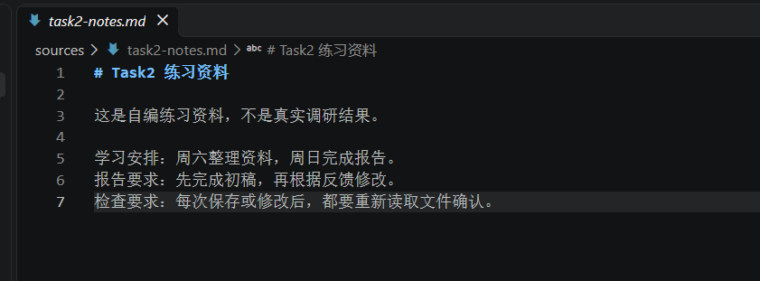
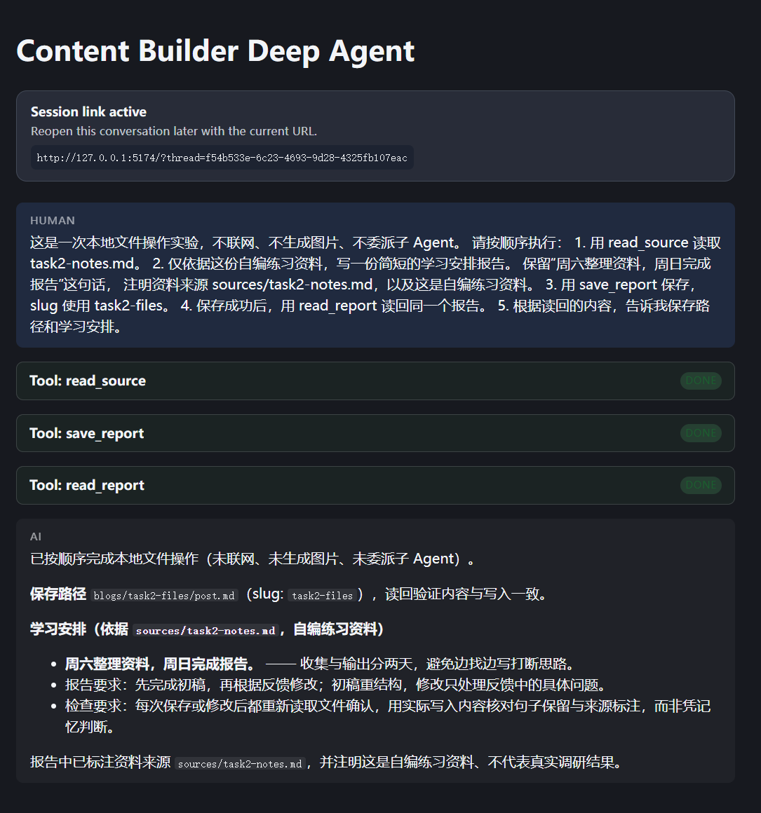
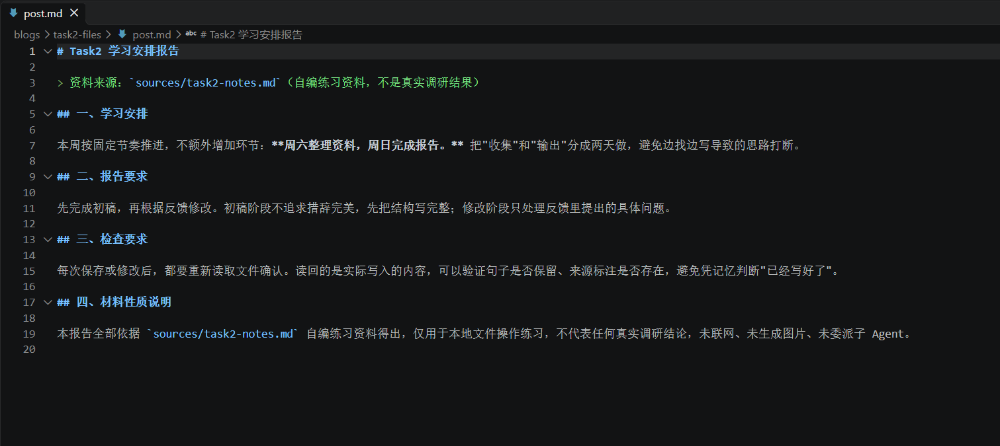
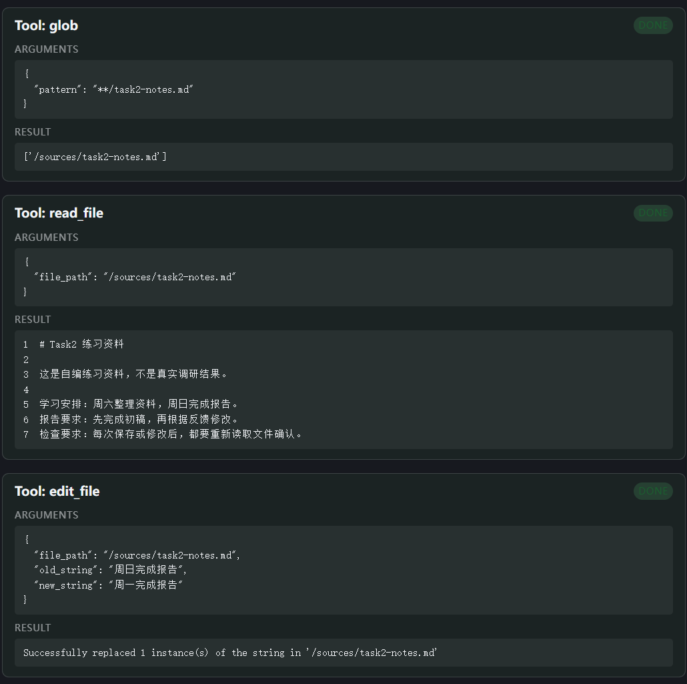
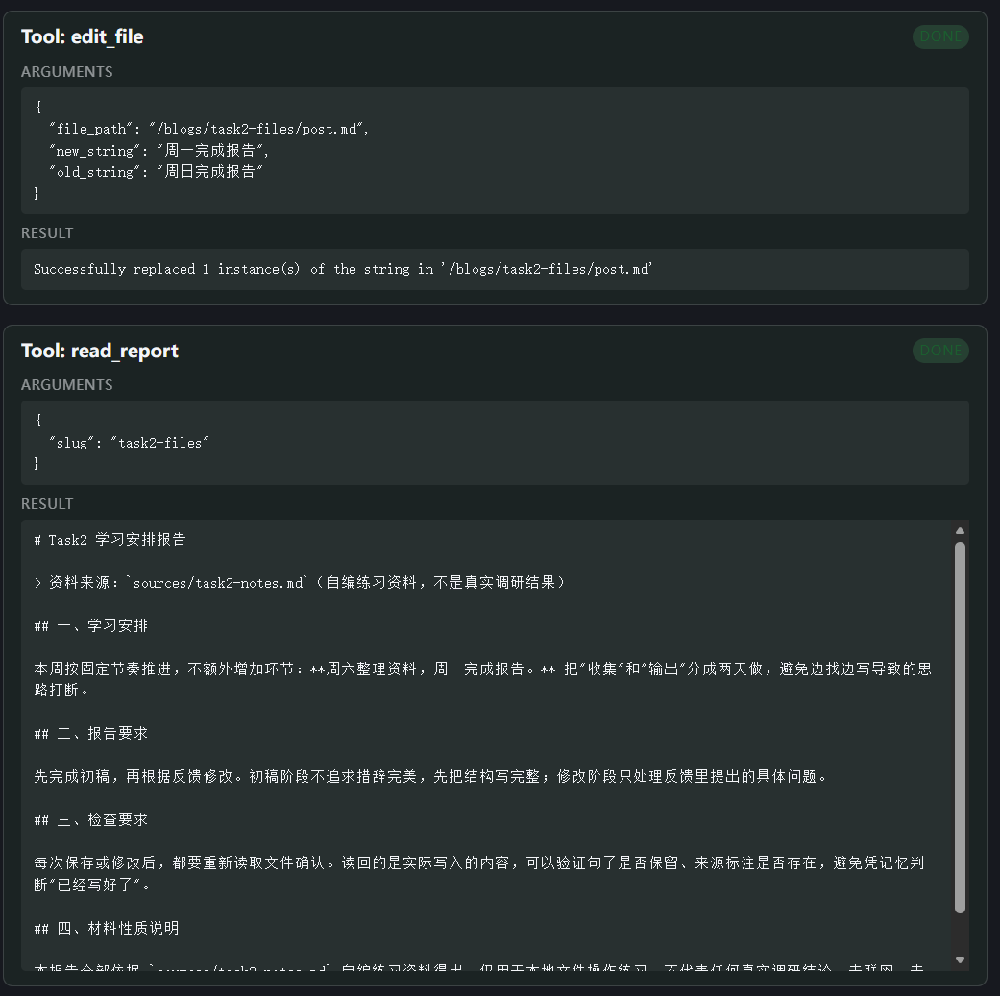
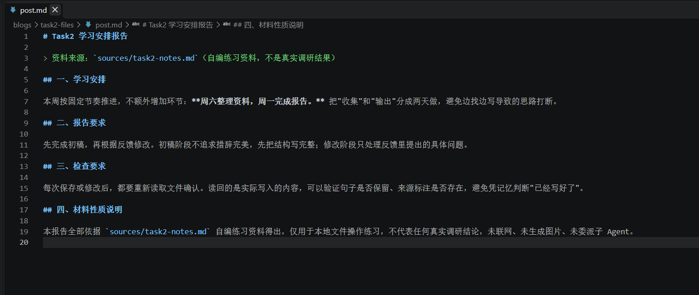

# Task 2：让资料和报告真正留在文件里

学习日期：2026-10-17。

## 1. 我验证了什么

Task 1 给研究助手加了一个长度检查工具。这次学习第 3 章，我想弄清楚报告怎样保存、怎样读回来，以及让 Agent 修改文件后，电脑里的内容是否真的变了。

我改用 `deepagents/content-builder` 模板，项目位于 WSL Ubuntu 的 `/home/lx/projects/content_builder_deepagent`。之前的 research 项目保留，Task 1 的工具这次没有移植过来。

这次做的是一次 live 文件操作实验，模型仍然是阿里云百炼北京地域的 `qwen3.8-flash`，通过 OpenAI 兼容接口接入。项目使用纯文本模式，关闭搜索和图片生成。实验资料是自己准备的几行学习安排，没有进行真实调研。

验证目标很具体：读取资料，生成并保存报告，再把完成日期从周日改成周一，确认资料和报告都更新了。最后同时检查前端工具结果、实际文件和 LangSmith Trace。

## 2. 换模板时遇到的问题

创建模板后，我安装了前后端依赖。前端虽然安装完成，但 `npm audit` 报了 5 个漏洞，涉及 Vite、Vitest 的依赖链。按照学习助手建议升级后，又遇到了 `ERESOLVE`。

报错里一直出现旧的 `@vitejs/plugin-react@4.7.0`。直接指定新版本安装失败，把版本先写进 `package.json` 再安装也失败了。后来把旧的 `node_modules` 和 `package-lock.json` 移到备份目录，再根据新配置安装，才成功。现有证据只能说明干净安装后冲突消失，具体是哪一处旧依赖状态触发了 npm 的解析问题，还没有进一步定位。

这次前端相关配置调整为：

| 依赖 | 原来的版本声明 | 调整后的版本 |
| --- | --- | --- |
| Vite | `^5.4.11` | `8.3.4` |
| React 插件 | `^4.3.4` | `6.1.2` |
| Vitest | `^3.2.4` | `4.1.11` |

升级后，我实际运行了测试和构建，终端结果是：

```text
found 0 vulnerabilities

Test Files  2 passed (2)
     Tests  11 passed (11)

vite v8.3.4 building client environment for production...
✓ 655 modules transformed.
✓ built in 296ms
```

这是当时终端输出的节选转录。构建还提示一个 JS 文件超过 500 kB，但构建本身通过了，暂时没有继续做体积优化。

之后 `agentseek doctor` 提示新项目缺少 `.env`，我从 `.env.example` 创建了配置，填好模型和 LangSmith 设置。启动日志出现 `Application startup complete` 和 `/ok` 的 `200 OK`，再进入页面做文件实验。

当前项目的 `uv.lock` 锁定 DeepAgents `0.7.8`、`agentseek-api 0.2.3`。环境准备完成后，我才进行下面的业务实验；实验中的主要变量只有完成报告的日期。

## 3. 我用到的文件和工具

### 文件后端在哪里配置

刚开始找代码时，我看到的是：

```python
from deepagents.backends import FilesystemBackend
```

我以为既然是从库里导入的，后端相关内容就都在 DeepAgents 里面。后来分清了，类的实现确实在库里，项目仍然需要创建对象并传入配置。当前模板的 `agent.py` 中有：

```python
EXAMPLE_DIR = Path(__file__).resolve().parents[2]
```

在 `build_graph()` 中：

```python
backend = FilesystemBackend(root_dir=EXAMPLE_DIR, virtual_mode=True)
```

然后将这个对象作为 `backend=backend` 传给 `create_deep_agent()`。

这里的根目录就是 content-builder 项目目录。开启虚拟路径后，Agent 操作的 `/` 对应该目录，因此这次两个文件的路径是：

| Agent 使用的路径 | Ubuntu 中的实际路径 |
| --- | --- |
| `/sources/task2-notes.md` | `/home/lx/projects/content_builder_deepagent/sources/task2-notes.md` |
| `/blogs/task2-files/post.md` | `/home/lx/projects/content_builder_deepagent/blogs/task2-files/post.md` |

### 模板工具和文件后端的区别

这次没有新增 Python 工具，主要使用模板已有的 `lesson_tools.py` 和内置文件工具。`save_report` 的原有实现如下：

```python
@tool
def save_report(slug: str, content: str) -> str:
    """Save a Markdown report to blogs/<slug>/post.md. Include headings and source paths."""
    target = _path("blogs", _slug(slug), "post.md")
    target.parent.mkdir(parents=True, exist_ok=True)
    target.write_text(content, encoding="utf-8")
    return f"Saved blogs/{slug}/post.md; use read_report to verify it."
```

其中 `_path()` 会以项目目录为起点生成路径，并检查解析后的路径仍在项目内；`_slug()` 检查名称格式。这次传入 `task2-files`，报告就保存到 `blogs/task2-files/post.md`。

| 工具 | 这次负责什么 | 文件操作方式 |
| --- | --- | --- |
| `read_source` | 根据文件名读取 `sources/` 下的资料 | 模板用 Python `Path.read_text()` 读取 |
| `save_report` | 保存 Markdown 报告 | 模板用 Python `Path.write_text()` 写入 |
| `read_report` | 根据 slug 读回报告 | 模板用 Python `Path.read_text()` 读取 |
| `glob`、`read_file`、`edit_file` | 查找、读取和修改虚拟路径对应的文件 | 使用配置的文件后端 |

所以，第一轮能保存报告，证明了模板保存工具确实写入了文件；第二轮用 `edit_file` 修改同一个文件，再由 `read_report` 读回，才把内置文件后端与模板工具的操作联系起来。Trace 中出现 `FilesystemMiddleware` 包装层，也不等于 `save_report` 内部改用了后端接口。

## 4. 两轮实验的结果与证据

### 第一轮：读取资料、保存初稿、读回确认

我在 `sources/` 下新建了 `task2-notes.md`，内容如下：

```markdown
# Task2 练习资料

这是自编练习资料，不是真实调研结果。

学习安排：周六整理资料，周日完成报告。
报告要求：先完成初稿，再根据反馈修改。
检查要求：每次保存或修改后，都要重新读取文件确认。
```



我让主 Agent 读取这份资料，生成简短的学习安排报告，保留“周六整理资料，周日完成报告”，注明来源和资料性质。随后用 `save_report` 保存，slug 为 `task2-files`，最后调用 `read_report` 验证。完整提示词整理在 [运行记录](../evidence/task2/run-record.md) 中。

页面展示了 `read_source`、`save_report`、`read_report` 三个工具，状态均为 `DONE`。保存工具返回：

```text
Saved blogs/task2-files/post.md; use read_report to verify it.
```



我在 VS Code 中打开 `blogs/task2-files/post.md`，看到了实际生成的报告。里面保留了“周日完成报告”，也标注了 `sources/task2-notes.md` 和自编练习资料的性质。



这轮的 [读取与保存参数](../evidence/task2-images/round1-read-save.png)、[报告读回结果](../evidence/task2-images/round1-read-report.png) 也保留了。

### 第二轮：只改完成日期，再分别读回

我在同一会话中要求把“周日完成报告”改成“周一完成报告”。先修改资料并读回，再修改报告并读回，保留其他内容。

两份文件中的目标变化都是：

```diff
- 周日完成报告
+ 周一完成报告
```

模型先调用了 `glob` 和 `read_file` 查找、读取资料，再请求 `edit_file`。资料修改的参数是：

```json
{
  "file_path": "/sources/task2-notes.md",
  "old_string": "周日完成报告",
  "new_string": "周一完成报告"
}
```

工具返回成功替换了 1 处。随后 `read_source` 读回的学习安排已经变成“周六整理资料，周一完成报告”。



模型接着读取报告，再对 `/blogs/task2-files/post.md` 做同样的替换。报告修改也返回成功替换 1 处，最后 `read_report` 读回的日期为周一。



两轮主要结果可以这样对照：

| 检查对象 | 第一轮 | 第二轮 |
| --- | --- | --- |
| 资料中的完成日期 | 周日 | 周一 |
| 报告中的完成日期 | 周日 | 周一 |
| 报告路径 | `blogs/task2-files/post.md` | 同一个文件 |
| 验证方法 | 保存后调用 `read_report`，再打开实际文件 | 两次局部替换后，分别读回资料与报告，再打开实际报告 |



修改后的 [资料文件](../evidence/task2/source-after.md) 和 [报告文件](../evidence/task2/report-after.md) 已复制到学习仓库，它们都写着“周一完成报告”。[第二轮整体截图](../evidence/task2-images/round2-overview.png) 和 [资料读回、报告修改前的内容](../evidence/task2-images/round2-source-read-report-before.png) 可以补充查看过程。

修改前的证据来自截图和工具读回记录；修改后的 Markdown 则保留了实际文件副本。

### LangSmith Trace

我查询了 `deepagents-course` 项目里的两次运行，并保存了 CLI 原始输出：

| 运行 | Trace ID（也是根 Run ID） | 总耗时 | 模型 Run | 工具 Run |
| --- | --- | --- | --- | --- |
| 第一轮：保存并读回 | `01a14a79-300d-78c2-b8bd-b9a3218b59fc` | 15.71 秒 | 4 | 3 |
| 第二轮：修改并读回 | `01a14a7c-5eb6-7762-b0bd-e334d777aba1` | 29.58 秒 | 8 | 7 |

第一轮的三个工具是 `read_source`、`save_report`、`read_report`。第二轮有 `glob` 1 次、`read_file` 2 次、`edit_file` 2 次、`read_source` 1 次、`read_report` 1 次，和页面展示的操作能够对应起来。

完整日志分别是 [trace-01.txt](../evidence/task2/trace-01.txt) 和 [trace-02.txt](../evidence/task2/trace-02.txt)。查询方式为：

```bash
langsmith trace get 01a14a79-300d-78c2-b8bd-b9a3218b59fc \
  --project deepagents-course --include-metadata \
  | tee /mnt/d/deepagents-in-action/evidence/task2/trace-01.txt

langsmith trace get 01a14a7c-5eb6-7762-b0bd-e334d777aba1 \
  --project deepagents-course --include-metadata \
  | tee /mnt/d/deepagents-in-action/evidence/task2/trace-02.txt
```

CLI 树形输出的排列不能直接当作时间顺序。比如第一轮日志把 `save_report` 列在 `read_source` 前面，不能据此判断模型先写后读；这次是结合前端工具参数、返回内容和文件结果进行核对的。

这两份树形输出记录了调用名称、层级和耗时，没有完整的输入输出、模型名称或 Token 数据。模型名称依据本地非敏感配置核对，工具参数和返回结果来自截图。列表里的 `STATUS`、`TOKENS` 显示 `N/A`，没有据此填写状态或用量。工具完成的依据是页面 `DONE`、实际返回内容和文件结果。

两轮树里都没有搜索或 `task` 工具节点。`SubAgentMiddleware` 是包装层，不能把它当成一次实际的子 Agent 委派。

### 对照打卡要求

| 要求 | 本次记录 |
| --- | --- |
| 验证什么 | 模板能保存报告、读取实际文件，并修改资料和报告后读回确认 |
| 改了什么 | 新建练习资料；生成报告后，将两份文件的完成日期从周日改为周一 |
| 一个主要变量 | 文件实验只调整完成日期，保留资料、报告的其他内容与模型配置 |
| 实际结果 | 初稿保存到 `blogs/task2-files/post.md`；资料和报告各替换一处，最终均为周一 |
| 证据与解释 | 修改前后截图、具体工具参数和返回值、修改后的实际文件副本、两轮 Trace |
| live 模型 | 阿里云百炼 `qwen3.8-flash`，完成两轮文件操作 |
| 下一步修正 | 补试找不到目标字符串时的处理，并在新会话或重启后读回文件；今后修改前先保留文件副本 |

## 5. 我的学习心得

这次换模板又花了不少时间，前端依赖报漏洞，升级时还连续遇到冲突。当时确实觉得只是换个模板，怎么会这么麻烦。最后安装通过还不够，又跑了测试和构建，才确认这套前端能继续使用。以后碰到依赖问题，我会先保留原配置和锁文件，再动手调整。

看文件后端时，我一开始把“类的实现在哪里”和“项目在哪里配置它”混在了一起。看到导入语句，就以为都封装在库里了。现在知道项目里的 `root_dir` 和 `virtual_mode` 会决定 Agent 看到的路径怎样对应到电脑上的文件，这让我读代码时更有方向。

真正让我理解保存和修改的，还是这次很小的日期实验。先在页面看到工具返回，再到 VS Code 打开报告，能确认它确实写到了磁盘上。第二轮把周日改成周一，资料和报告分别修改、分别读回，我才发现修改资料不会自动同步报告，需要让 Agent 继续操作对应的文件。

Task 1 让我分清了工具结果和消息上下文，这次又把消息里的回复和磁盘上的报告分开了。页面里说“已修改”之后，我现在会去看工具实际返回了什么，再看保存下来的文件。两个地方都能对上，比只看最终回答更让我放心。

## 6. 下一步

这次先把保存、读回和修改跑通了。后面我想试试目标字符串不存在时，`edit_file` 会怎样返回，Agent 会不会如实说明没有改成功。也准备在新会话或重启服务后读同一个报告，继续确认文件保存与会话上下文的区别。下次做修改前，先保存一份原文件，方便直接比较前后变化。

## 参考来源

- [课程第 3 章：虚拟文件系统](https://datawhalechina.github.io/deepagents-in-action/chapters/ch03-virtual-filesystem/)
- [AgentSeek：content-builder 模板](https://github.com/agentseek-ai/agentseek-templates/tree/main/templates/deepagents/content-builder)
- 本地项目 `src/content_builder_deepagent/agent.py`：后端配置；`src/content_builder_deepagent/lesson_tools.py`：资料读取、报告保存与读回工具。
- 本次前端截图、实际文件副本和 LangSmith CLI 输出，见正文中的仓库链接。
