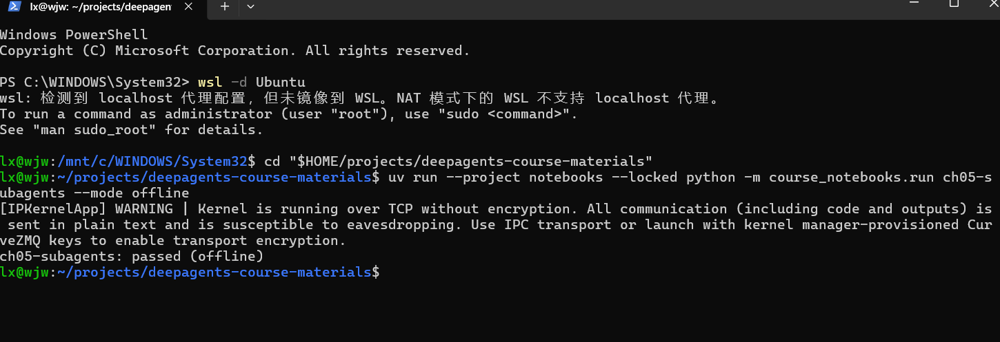
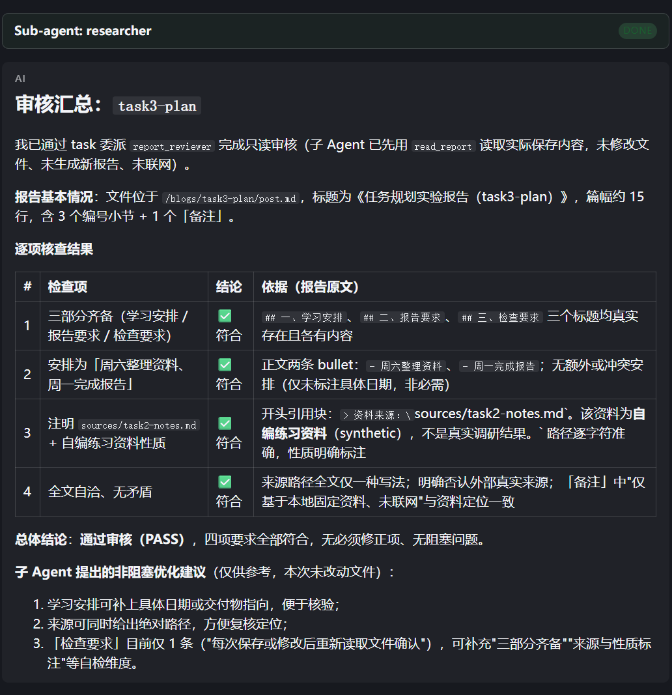

# Task 4：把报告审核交给子 Agent

学习日期：2026-10-24。

## 1. 这次想验证什么

看完第 5 章后，我用配套 Notebook 观察了一次子 Agent 委派，再给已有的 content-builder 项目加了一个报告审核员。主 Agent 负责接收要求和汇总意见，子 Agent 负责读取已经保存的报告，逐项检查内容。

这次想确认的不是最终回答里有没有写“已委派”，而是主 Agent 有没有真的调用 `task`、指定的子 Agent 有没有运行，以及报告读取是否发生在它内部。实际项目仍位于 `/home/lx/projects/content_builder_deepagent`，沿用阿里云百炼 `qwen3.8-flash`，使用本地资料，不开启联网搜索和图片生成。

## 2. 先跑配套 Notebook

我在 Ubuntu 终端执行：

```bash
cd "$HOME/projects/deepagents-course-materials"
uv run --project notebooks --locked python -m course_notebooks.run ch05-subagents --mode offline
```

结果是：

```text
ch05-subagents: passed (offline)
```



这次生成的 Notebook 显示 Python `3.12.3`、`Linux x86_64`、DeepAgents `0.7.22`。它和主项目使用独立环境，主项目的 DeepAgents 仍是 `0.7.8`。

Notebook 中，主 Agent 通过 `task` 把固定 A/B 方案比较交给 `researcher`。子 Agent 用 `lookup_case` 读取资料，再写入报告，最后返回简短结论和文件路径。输出里有两段让我更容易理解第五章讲的边界：

```text
主 Agent 收到的工具结果名: ['task']
已验证：子 Agent 工具记录未并入主消息，主 Agent 第一轮尚未主动读文件。

已读回共享状态中的完整报告： 4 行
已验证：消息上下文隔离，文件状态共享；主 Agent 主动读取后才看到文件内容。
```

也就是说，主 Agent 收到的是委派结果，子 Agent 内部的每一步工具消息不会自动展开到主 Agent 的消息里；但本例的文件状态可以回传，主 Agent 主动读取后，正文才进入它的工具消息。

这里使用的是脚本模型，工具和图确实执行了，但报告结论和工具选择按脚本安排。这次 offline 成果属于**机制验证**，不能证明真实模型会自行遵守审核职责。另外，Notebook 默认用 `StateBackend` 保存虚拟文件，不应去 Ubuntu 磁盘上寻找 `/research/cache-choice.md`；主项目使用的则是磁盘文件后端。

我保留了本次实际执行的 [Notebook](../evidence/task4/notebook/ch05-subagents.ipynb)、[Markdown 输出](../evidence/task4/notebook/ch05-subagents.md)、[HTML 输出](../evidence/task4/notebook/ch05-subagents.html) 和 [运行报告](../evidence/task4/notebook/report.json)。

## 3. 给主项目增加本地报告审核员

我原本准备按说明自己插入代码，找 `memory_sources` 时还没找到位置。后来确认它就在创建 Agent 之前，我请学习助手直接完成修改，再由我启动应用进行真实调用。下面记录的是这次协助完成的代码，不把它写成我独立实现的成果。

### 声明职责和工具

原有 YAML 中的 `researcher` 面向联网研究，而且只有开启搜索时才会加载。当前项目运行在文本模式，所以这次在 `agent.py` 的 `build_graph()` 中新增了 `report_reviewer`：

```python
report_reviewer = {
    "name": "report_reviewer",
    "description": (
        "审核已经保存的本地报告。"
        "检查报告内容、资料来源和指定要求是否一致。"
        "委派时必须提供报告 slug 和具体检查要求。"
    ),
    "system_prompt": (
        "你是本地报告审核员。"
        "收到报告 slug 后，必须先调用 read_report 读取实际报告，"
        "不能仅根据任务描述推测报告内容。"
        "根据主 Agent 提供的检查要求逐项审核，"
        "每项说明是否符合，并引用报告中的简短文字作为依据。"
        "如果读取失败或证据不足，明确说明无法确认。"
        "最后给出通过或不通过的结论及问题列表。"
        "只返回审核意见，不修改或保存文件，"
        "不联网、不生成图片、不委派其他 Agent。"
    ),
    "model": chat_model,
    "tools": [read_report],
}
```

这几个字段各有用途：`name` 用于指定委派对象，`description` 帮主 Agent 判断何时使用它，`system_prompt` 指导子 Agent 自己工作，`tools` 显式提供报告读取工具。`model` 复用当前模型实例，但复用模型配置不等于主、子 Agent 共用一份消息上下文。

### 注册到主 Agent

本地审核员在文本模式下也需要存在，原有联网研究员则继续受搜索开关控制：

```python
configured_subagents = [report_reviewer]
if search:
    configured_subagents.extend(
        _load_subagents(EXAMPLE_DIR / "subagents.yaml")
    )
```

`create_deep_agent()` 中的注册从原来按搜索开关选择整个列表，改为：

```diff
- subagents=_load_subagents(EXAMPLE_DIR / "subagents.yaml") if search else [],
+ subagents=configured_subagents,
```

主 Agent 的系统提示词也补充了：报告审核通过 `task` 委派给 `report_reviewer`，任务中需要带上报告 slug 和具体检查要求。

本次主要变量是增加“本地报告审核子 Agent”这一项能力。职责、提示词、工具和注册围绕这个功能一起接入，模型、固定资料和已有报告保持原样。没有为了使用审核员打开搜索，也没有同时重写其他功能。

修改前后源码与补丁分别保存在 [agent-before.py](../evidence/task4/code/agent-before.py)、[agent-after.py](../evidence/task4/code/agent-after.py) 和 [agent-change.patch](../evidence/task4/code/agent-change.patch)。

### 无模型检查

学习助手先增加了一个脚本模型测试，检查主 Agent 能否通过 `task` 委派审核，子 Agent 能否读到实际报告，以及主消息里是否只收到 `task` 工具结果。接入审核员之前测试失败，接入后通过。随后语法检查通过，完整课程检查结果为：

```text
15 passed in 16.86s
```

[测试代码归档](../evidence/task4/code/test-course-after.py) 和 [检查结果转录](../evidence/task4/checks.txt) 已保留。这验证了接入机制，真实模型是否按要求审核，还需要下面的 live 运行来观察。

## 4. 真实模型审核与 Trace

我启动应用，在新会话中要求主 Agent 将 `task3-plan` 报告交给审核员，检查三个部分是否齐全、学习安排是否为周六整理资料和周一完成报告、是否注明来源与自编练习资料性质。要求子 Agent 先读取实际文件，主 Agent 再汇总意见，不修改文件、不生成新报告、不联网。完整请求整理在 [运行记录](../evidence/task4/run-record.md) 中。

页面最终返回了逐项核查表，审核结论为通过，还给出了三条可选优化建议。



最开始截图顶部显示的是 `Sub-agent: researcher`，但正文说委派给了 `report_reviewer`。查询 Trace 后，实际调用参数是：

```json
{
  "subagent_type": "report_reviewer",
  "description": "审核 task3-plan，先读取实际报告，再按具体要求返回审核意见。"
}
```

这里的 `description` 是为便于阅读而作的摘要；[原始工具记录](../evidence/task4/tool-runs.json) 保留完整任务说明。

Trace 结构可以对应到：

```text
LangGraph
└─ task(subagent_type="report_reviewer")
   └─ report_reviewer
      ├─ read_report(slug="task3-plan")
      └─ ls(path="blogs/task3-plan")
```

这是省略包装节点后的层级摘要，工具先后按 Run 时间核对，不能只看树形输出排列。`read_report` 确实位于审核子 Agent 内部；主 Agent 发出的委派说明包含了报告 slug 和检查要求。

| 项目 | 本次记录 |
| --- | --- |
| 模型 | 阿里云百炼 `qwen3.8-flash`，按本地配置核对 |
| LangSmith 项目 | `deepagents-course` |
| 根 Trace / Run ID | `01a169b4-0d6b-76a0-9aeb-828767ed9a7b` |
| 总耗时 | 53.30 秒 |
| 模型调用 | 5 次：主 Agent 2 次，审核员 3 次 |
| 工具调用 | 3 次：委派工具 `task` 1 次，子 Agent 内部 `read_report`、`ls` 各 1 次 |
| 实际产物 | 已有报告的审核意见，未生成新报告 |

本轮没有保存或编辑工具调用。当前被审核文件与 Task3 归档副本内容一致。[被审核报告](../evidence/task4/reviewed-report.md)、[子 Agent 的审核意见](../evidence/task4/reviewer-feedback.md)、[完整 Trace 树](../evidence/task4/trace-tree.txt) 和 [工具输入输出](../evidence/task4/tool-runs.json) 均已归档。审核意见是模型返回的原文，不代表所有判断都已经过独立评测。

### 为什么页面还写着 researcher

前端 `ToolCallCard.tsx` 将名称为 `task` 的卡片标题固定写成了 `Sub-agent: researcher`，没有按实际 `subagent_type` 展示。[相关源码节选](../evidence/task4/frontend-label-excerpt.txt) 已保留。

所以这次以工具参数和 `report_reviewer` 子流程为准，不能把界面固定标签当成委派对象。这个显示问题本轮只记录，没有修改前端，也没有为了截图重跑模型。

另一个观察是，虽然我只给审核员显式注册了 `read_report`，它仍调用了 `ls`。`tools=[read_report]` 指的是这次提供的自定义工具，不代表框架没有给子 Agent 配置其他内置工具。因此“不要修改文件”目前是职责提示，不应理解为已经实现了权限隔离。

## 5. 我的学习心得

这次看完第五章后，我知道可以把一项工作交给子 Agent，但真要改项目，还是需要有人帮我找到代码位置。新增审核员的代码和测试由学习助手协助完成，我自己运行了 Notebook 和应用，再根据结果确认它是否真的接手了审核。这部分还需要继续练习，不能把跑通一次当成已经能独立写出来。

Notebook 让我对“上下文隔离”有了具体印象。主 Agent 收到的是 task 的返回，子 Agent 的工具记录不会全部塞进主消息里；但文件仍然可以共享。以前我容易把“消息没传过来”和“文件也不能访问”混在一起，这次能分开看了。

实际审核时，页面标签和正文里的名字又对不上。我原本只看到了一个完成的审核结果，后来查到 task 参数确实指定了 report_reviewer，才知道是前端把名称写死了。以后我会优先看实际调用参数，而不是只凭页面标题判断。

审核员还多调用了一次 ls，也让我意识到，给子 Agent 配置一个自定义工具，并不意味着它只剩下这一个工具。职责、工具列表和权限边界是几件相关但不同的事。现在我能把主 Agent 委派、子 Agent 读取、返回意见、主 Agent 汇总这条过程对应起来了。

## 6. 下一步

这次审核的是本来就符合要求的报告，还没有验证审核员能否发现问题。后面准备复制一份练习报告，只删除来源说明或改错一个日期，再看它能否指出具体位置和依据。先保持模型、审核提示词和其他条件不变，避免一次改太多东西。前端子 Agent 名称固定显示的问题，也留作后续的小修正。

## 参考来源

- [课程第 5 章：子 Agent 与上下文隔离](https://datawhalechina.github.io/deepagents-in-action/chapters/ch05-subagents/)
- [配套 Notebook 源文件](https://github.com/datawhalechina/deepagents-in-action/blob/f93fe0a8be843eae77efaf85448035ddc54ff7ea/notebooks/ch05/01-subagent-delegation.ipynb)
- [AgentSeek：content-builder 模板](https://github.com/agentseek-ai/agentseek-templates/tree/main/templates/deepagents/content-builder)
- 本地项目的 `agent.py`、无模型测试、前端标签源码，以及正文链接中的实际运行证据。
