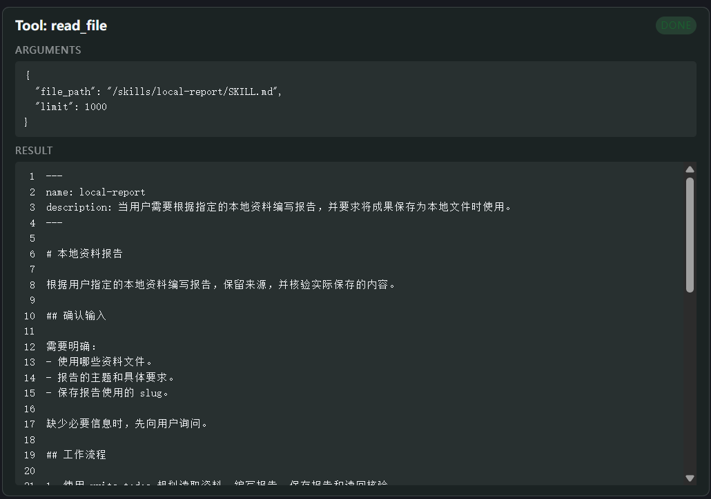
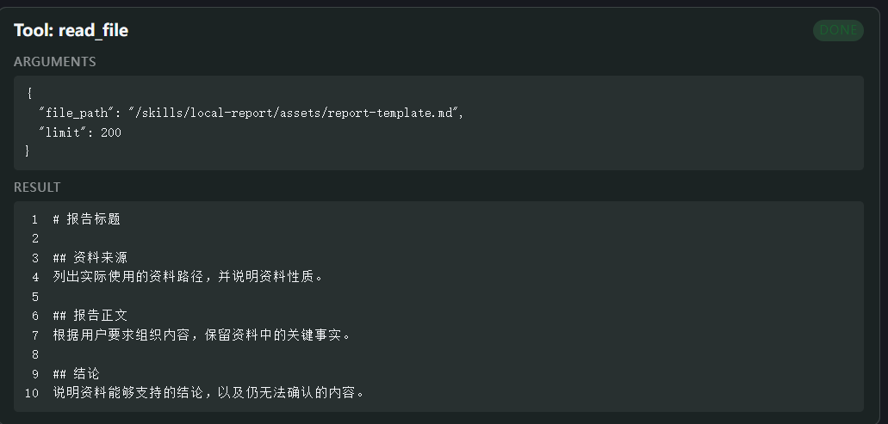
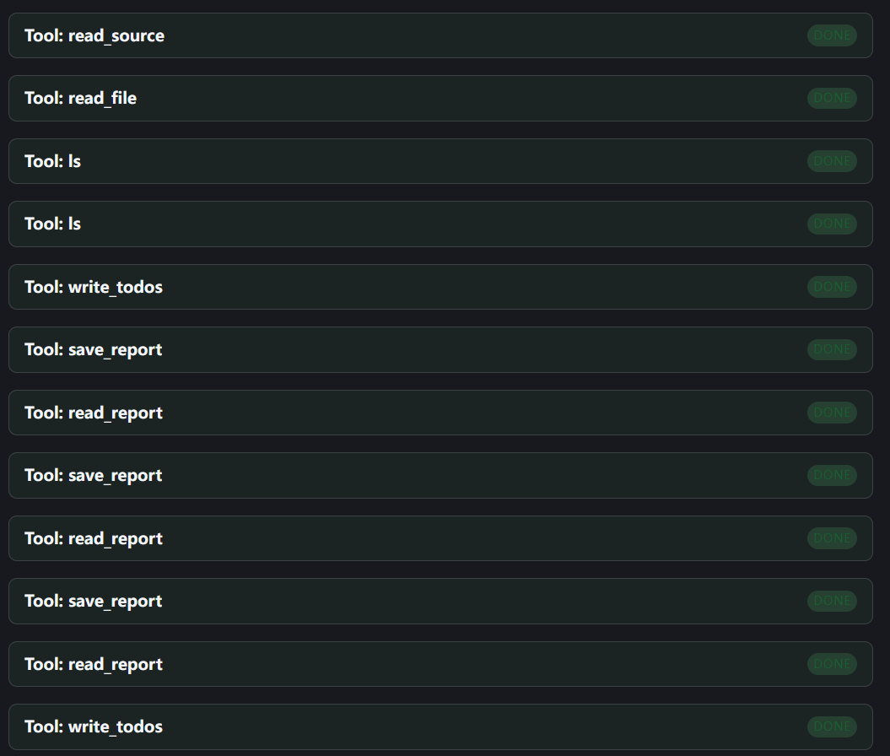
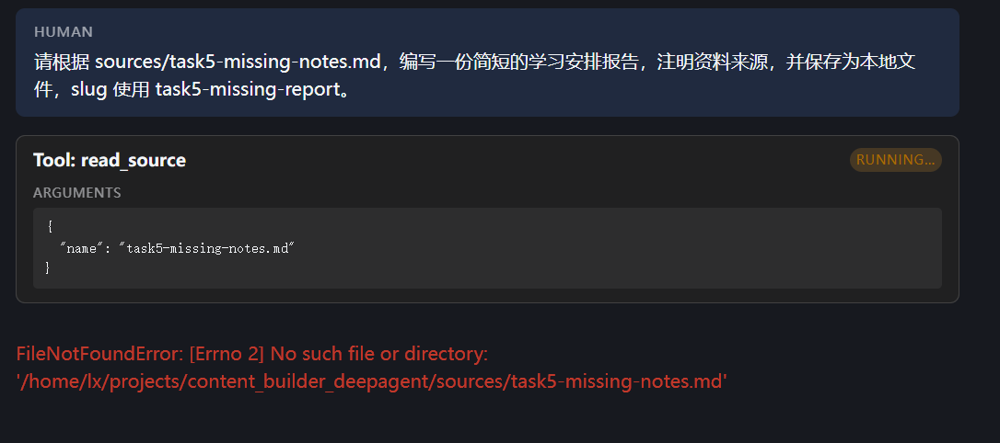
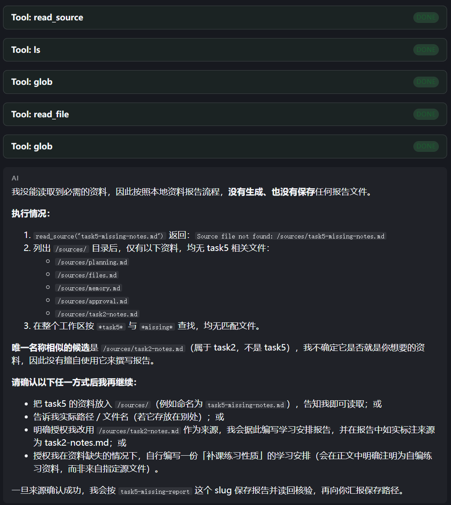

# Task 5：把本地报告流程整理成 Skill

学习日期：2026-10-27。

## 1. 这次想验证什么

前几次实验里，我已经用过读取资料、保存报告和读回核验。这次学习第 7 章，准备把这些做法整理到主项目的 `skills` 目录，以后提出报告需求时，不用再把工具调用步骤重复写一遍。

主项目继续使用 `deepagents/content-builder`，模型仍是阿里云百炼 `qwen3.8-flash`。这次做的是 **live 实验**，使用本地自编资料，不联网、不生成图片，也不委派子 Agent。

我想确认两件事：一是提示词不点名 Skill 时，Agent 能不能选择并读取它，再按模板生成报告；二是必需资料不存在时，它能不能说明问题、向我询问，而不是直接编出一份报告。

## 2. 新增了什么

项目原来已经有 `blog-post` 和 `social-media` 两个 Skill，`agent.py` 中也已经配置了：

```python
skills=["/skills/"]
```

因此这次没有改加载配置，而是新增一个更适合本地资料报告的 Skill：

```text
skills/
└── local-report/
    ├── SKILL.md
    └── assets/
        └── report-template.md
```

文件内容由学习助手协助整理，我在项目中创建、保存后，再运行验证。归档中保留了实际使用的 [SKILL.md](../evidence/task5/skills/local-report/SKILL.md) 和 [报告模板](../evidence/task5/skills/local-report/assets/report-template.md)。它们是主项目给 Agent 使用的流程文件。

### 用 description 说明适用场景

我一开始写的是“当用户需要编写报告时使用”。思考后发现范围太大，联网调研报告也可能被匹配进来，最后改成：

```yaml
---
name: local-report
description: 当用户需要根据指定的本地资料编写报告，并要求将成果保存为本地文件时使用。
---
```

`description` 帮模型判断什么时候应该读取这个 Skill；正文再说明具体怎么做。正文要求先确认资料、报告要求和 slug，再读取资料和模板，编写报告，调用 `save_report` 保存，最后用 `read_report` 读回检查。

报告模板只规定“资料来源、报告正文、结论”三个部分，不提供事实内容。资料文件名、报告主题和 slug 由每次请求决定，没有把之前的 `task2-notes.md` 写死在流程里。

### 加上资料缺失时的处理方法

我提出：第一次找不到时先查找一次，仍找不到再询问。整理后的规则限定在 `/sources/` 目录中查找；如果只有相似文件名，先确认，不能直接拿另一份资料替代。必需资料没有成功读取前，不生成或保存正式报告，也不把相关任务标成完成。

这部分来自之前 Task3 的经验。当时缺少资料，Agent 还是保存了一份缺失说明；这次我希望先停下来确认。

## 3. 正常资料实验

测试继续使用已有的自编练习资料 [task2-notes.md](../evidence/task5/source.md)，内容包括：周六整理资料、周一完成报告；先写初稿，再根据反馈修改；每次保存或修改后重新读取文件确认。

我发送的请求是：

```text
请根据 sources/task2-notes.md，编写一份简短的学习安排报告，包含学习安排、报告要求和检查要求，注明资料来源及其性质。请将报告保存为本地文件，slug 使用 task5-local-report。
```

这里没有要求“使用 local-report”，也没有把保存、读回的工具顺序写进提示词。实际第一步是读取 Skill：



随后它读取资料，再读取模板：



Trace 中能够对应到下面的过程，省略了中间的 Todo 更新和目录检查：

```text
read_file(/skills/local-report/SKILL.md)
→ read_source(task2-notes.md)
→ read_file(/skills/local-report/assets/report-template.md)
→ save_report → read_report
→ save_report → read_report
→ save_report → read_report
→ 更新 Todo，返回结果
```



最终文件位于 `blogs/task5-local-report/post.md`。报告包含指定的三项内容，也注明了来源是自编练习资料。[最终报告](../evidence/task5/report-final.md) 已从实际项目复制归档，内容与第三次保存及最后一次读回一致。

### 为什么保存了三次

最终回答说它修正了超出资料的推断。核对三次 `save_report` 的内容后，确实能看到变化：

| 版本 | 报告中的文字 |
| --- | --- |
| 第一版 | “中间留出从周六到周日的消化时间。” |
| 第二版 | “两者之间留出周末时间。” |
| 第三版 | “整理节点在前，成文节点在后。” |

原资料只写了周六整理、周一完成，没有说明中间安排了消化时间。第二版还保留着类似推断，第三版才删掉。每一次保存后都有对应的 `read_report`，三组写入与读回内容分别一致。

这说明本轮出现了修改和复核，但不能因此认为读回一次就一定能发现所有问题。三份版本保存在 [reports 目录](../evidence/task5/reports/)，也可以直接查看 [版本差异](../evidence/task5/reports/revisions.diff)。

## 4. 缺失资料实验与工具修正

接着，我把请求中的资料改成不存在的 `sources/task5-missing-notes.md`，保存名称改成 `task5-missing-report`，希望观察查找和询问过程。

第一次没有走到询问，`read_source` 直接抛出了 `FileNotFoundError`，运行中断：



学习助手检查源码并用本地工具复现后，确认原函数直接调用 `Path.read_text()`，没有处理文件不存在的异常。Skill 虽然写了后续做法，但模型没有收到可供继续处理的工具结果。

按指导，我在 `lesson_tools.py` 中导入 `ToolException`，给 `read_source` 增加了处理：

```python
from langchain_core.tools import tool, ToolException


@tool
def read_source(name: str) -> str:
    """Read a fixed course source by filename, such as planning.md or files.md."""
    if not re.fullmatch(r"[a-z0-9_-]+\.md", name):
        raise ValueError("Use a Markdown filename from sources/")

    try:
        return _path("sources", name).read_text(encoding="utf-8")
    except FileNotFoundError as exc:
        raise ToolException(
            f"Source file not found: /sources/{name}"
        ) from exc


read_source.handle_tool_error = True
```

这是原文件中的局部代码，仍使用文件中已有的 `re` 和 `_path`；[修改后完整文件](../evidence/task5/code/lesson_tools-after.py) 已保留。这次只处理“文件不存在”，没有把权限等其他异常都包装成同一种错误。

修改前，学习助手先在内存中验证了缺失文件返回 `error`、正常文件仍能读取，没有调用模型。随后我把修正应用到项目，保持 Skill 和测试提示词不变，再进行 live 测试。

### 修正后的结果

这次 `read_source` 返回了：

```text
status: error
Source file not found: /sources/task5-missing-notes.md
```

运行继续了，Agent 查找资料后向我询问，没有直接使用 `task2-notes.md` 替代，也没有调用 `save_report`。归档时检查，`blogs/task5-missing-report/post.md` 不存在。



不过，这轮没有完全按 Skill 执行。按工具开始时间核对，实际顺序是：

```text
read_source(task5-missing-notes.md) → 返回 error
ls(path="/sources")
glob(pattern="**/*task5*")
read_file(/skills/local-report/SKILL.md)
glob(pattern="**/*missing*")
最终回复：说明缺失，询问如何补充资料
```

它先查找，之后才读取 Skill；两次 `glob` 也没有限定在 `/sources/`。因此，这次只能确认“收到错误后继续处理、没有生成报告、向用户询问”，不能写成严格遵守了所有规则。另外，这一轮没有调用 `write_todos`，没有可用的 Todo 状态更新，不能把最终回复中的“未完成”当成清单状态证据。

### 三次运行的 Trace

模型均为 `qwen3.8-flash`，通过 OpenAI 兼容适配器调用；Trace 中的 DeepAgents 版本为 `0.7.8`。

| 运行 | 耗时 | 模型 / 工具调用 | 根 Trace ID |
| --- | --- | --- | --- |
| 正常报告 | 83.93 秒 | 15 / 14 | `01a178fb-2074-7a71-a0e9-6d7b6bf2a054` |
| 缺失资料，修正前 | 4.00 秒 | 1 / 1 | `01a17900-8dba-7983-a452-bdd2f708137c` |
| 缺失资料，修正后 | 29.59 秒 | 6 / 5 | `01a17908-2c86-77d3-b8ea-fcf42ac30bc6` |

三次记录分别保留了 [正常 Trace](../evidence/task5/normal-trace.txt)、[中断 Trace](../evidence/task5/missing-before-trace.txt) 和 [修正后 Trace](../evidence/task5/missing-after-trace.txt)。[运行记录](../evidence/task5/run-record.md) 链接了对应的工具输入输出和核验结果。

正常报告和第一次缺失资料请求使用同一个 thread，修正后的请求换了新 thread，所以它们不是完全独立、同上下文的对照实验。这里记录具体行为，不用耗时差异证明 Skill 效果变好了。

## 5. 我的学习心得

这次我先弄清了 Skill 和工具的区别。Skill 里写“调用 save_report”，这句话不会自己执行 Python 函数；模型要先读到说明，再提出调用请求，由框架执行。看英文的 blog-post 文件时，我还需要逐段解释，拆开看以后才明白，前面的 description 负责说明适用场景，正文负责写工作方法。

我最初只写“需要编写报告时使用”，现在知道这句话太宽泛。把“指定的本地资料”和“保存为本地文件”补上，才更接近这个 Skill 的用途。资料名和报告名称留给每次请求决定，固定下来的是做事步骤，这样才有复用的意义。

缺资料测试让我看到了另一层问题：我已经在 Skill 中写了“找不到就询问”，但 Python 异常让运行直接中断，模型根本没有机会处理。工具怎样返回错误，也是流程能否继续的一部分。

后来它能继续查找并询问了，我原本以为这样就算符合要求。查 Trace 后才发现，查找范围和读取 Skill 的顺序还是有偏差。最终回答看起来合理，不代表每一步都按我写的规则做了。以后写完 Skill，我会把它当成需要实际检查的工作说明，而不是写上去就一定生效的程序。

## 6. 下一步

后面先把资料缺失的查找要求写得更具体，给出限定在 `/sources/` 内的匹配示例，再用新会话检查是否仍然扩大范围。一次只调整这条规则，保持模型和资料条件不变。需要强制限制的范围，再考虑通过工具或权限配置约束，不能只依赖提示词。本次先保留实际结果，不把尚未验证的调整写成已经完成。

## 参考来源

- 课程本地文件：`content/ch07-skills.md`。
- [Datawhale：第 7 章 Skills](https://github.com/datawhalechina/deepagents-in-action/blob/main/content/ch07-skills.md)。
- [AgentSeek：content-builder 模板](https://github.com/agentseek-ai/agentseek-templates/tree/main/templates/deepagents/content-builder)。
- 本文链接的实际 Skill、模板、报告、工具源码、截图和 LangSmith 查询记录。
