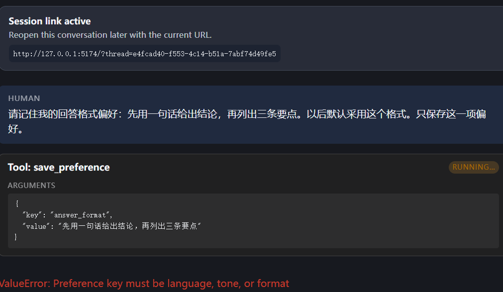
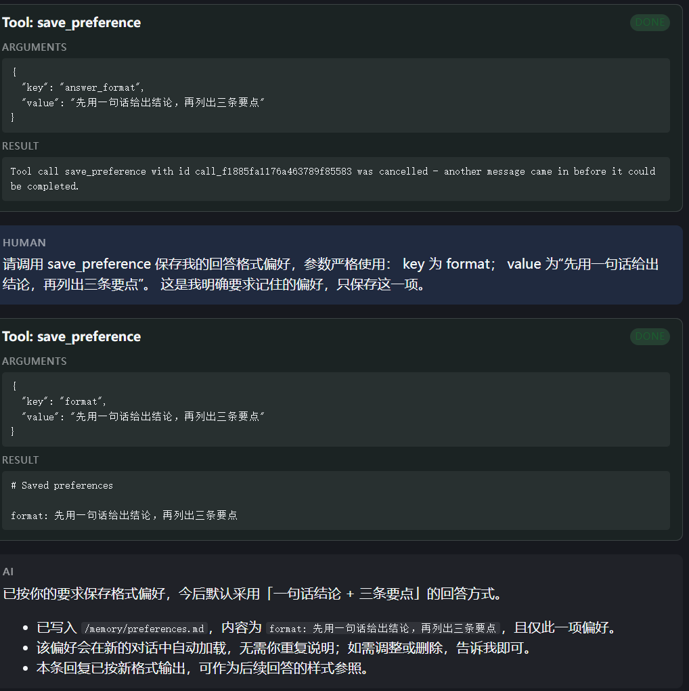
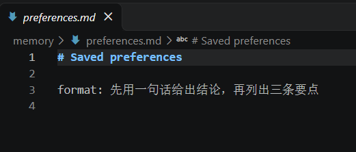
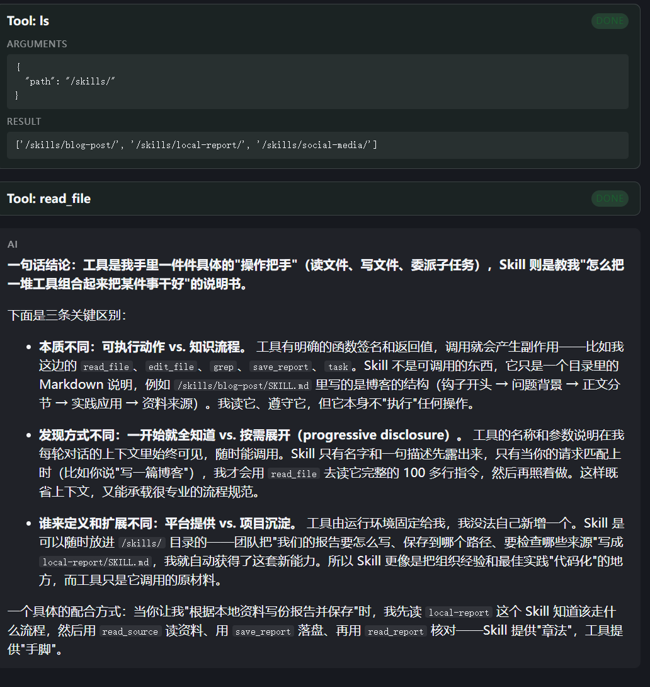

# Task 6：记住偏好，执行前等待审批

学习日期：2026-10-29。

## 1. 这次想验证什么

这次学习第 8—9 章，继续使用 content-builder 主项目，分别验证文件记忆和本地工具审批。模型仍是阿里云百炼 `qwen3.8-flash`，本次记录的是 **live 实验**。

记忆部分，我想让 Agent 保存一项回答格式偏好，再换一个新会话，看看它能否继续使用。审批部分，我想确认模型提出发布请求后，工具不会马上执行；批准时执行一次，拒绝时不执行。

模板已经提供了 `save_preference`、记忆加载配置和 `approval_demo.py`。本轮沿用这些实现，没有新增记忆中间件或改写审批代码。实际改变的是偏好文件中的内容；审批的两次测试只切换 `approve` 和 `reject`，分别观察记录是否增加。

## 2. 把偏好保存到文件

项目的记忆来源已经配置为：

```python
memory_sources = ["/AGENTS.md", "/memory/preferences.md"]
```

同一份文件列表用于 `MemoryMiddleware` 和 `create_deep_agent()` 的 `memory` 参数。`AGENTS.md` 保存项目说明，`memory/preferences.md` 保存明确要求记住的偏好。系统提示要求只有用户明确提出时才调用 `save_preference`，不能自行推断并保存其他偏好。[实际配置源码](../evidence/task6/code/agent.py) 已归档。

我先发送：

```text
请记住我的回答格式偏好：先用一句话给出结论，再列出三条要点。以后默认采用这个格式。只保存这一项偏好。
```

### 第一次传错了 key

模型把参数写成了：

```json
{
  "key": "answer_format",
  "value": "先用一句话给出结论，再列出三条要点"
}
```

但工具只接受 `language`、`tone`、`format`，所以抛出 `ValueError`，这次没有成功保存。



这次先没有修改工具，而是在提示词中明确要求 key 使用 `format`，value 使用原来的偏好文字。重试后，工具返回了实际文件内容：

```markdown
# Saved preferences

format: 先用一句话给出结论，再列出三条要点
```



重试实际仍在原来的 thread 中进行。截图里的旧调用后来显示为 cancelled，并带着绿色 DONE；首次 Trace 记录的则是 `ValueError`。因此我没有把这个显示当成旧调用成功，保存成功的依据是第二次工具返回，以及磁盘文件内容一致。



文件位于 `/home/lx/projects/content_builder_deepagent/memory/preferences.md`，归档副本见 [preferences.md](../evidence/task6/preferences.md)。

## 3. 换一个会话验证记忆

保存后，我新建会话，只问：

```text
请解释一下 Skill 和工具有什么区别
```

这次没有重复格式要求。回答先给了一句结论，再列了三条区别，最后还补充了一个配合使用的例子。主体采用了保存的格式，但不能把它写成严格只输出一句话和三条要点。



只看回答还不能确认偏好从哪里来，所以学习助手进一步查询了已有 Trace：

| 检查 | 实际结果 |
| --- | --- |
| 保存偏好的 thread | `e4fcad40-f553-4c14-b51a-7abf74d49fe5` |
| 新问答的 thread | `12d67ff5-7edb-40d6-bd99-0927c3cc4e1c`，与前者不同 |
| 新会话首次模型请求 | 包含文件中的回答格式偏好 |
| 旧的保存请求 | 没有出现在新会话首次模型请求中 |

这里把“文件确实保存”“新会话确实加载”“回答有所体现”分别核对了。模型请求保存在 [memory-first-model-request.json](../evidence/task6/memory-first-model-request.json)，实际回答原文保存在 [memory-read-reply.md](../evidence/task6/memory-read-reply.md)。

本轮的 `read_file` 读的是 `/skills/blog-post/SKILL.md`，不是偏好文件。偏好由中间件加载到请求中，不要求模型先调用一次 `read_file` 才能使用。这个项目的文件记忆也只属于当前项目副本，不是按账号隔离的全局记忆。

## 4. 本地工具审批

当前网页没有批准、拒绝按钮，所以这部分使用模板自带的 SDK 脚本。`publish_report` 只向本地 `reports/publications.jsonl` 追加一条测试记录，不会向外部网站发布报告。

### 先看暂停和恢复的位置

脚本使用同一个图工厂，显式传入内存 Checkpointer 并打开审批配置：

```python
graph = build_graph(model, checkpointer=InMemorySaver(), approvals=True)
config = {"configurable": {"thread_id": str(uuid4())}}
```

图工厂为发布工具设置的审批规则是：

```python
interrupt_on={
    "publish_report": {"allowed_decisions": ["approve", "reject"]}
}
```

模型提出发布请求后，脚本检查 `__interrupt__`，核对待审批的工具名和参数，再检查日志没有提前增加。随后通过下面这句恢复同一 thread：

```python
resumed = graph.invoke(
    Command(resume={"decisions": [{"type": decision}]}),
    config,
)
```

以上是已有实现的关键部分，完整文件保存在 [approval_demo.py](../evidence/task6/code/approval_demo.py)。这里的决定由命令行参数预先给出，脚本仍然经历暂停和恢复，但不会停下来让我现场输入选择。

### 批准：记录从 0 变成 1

我在 Ubuntu 终端执行：

```bash
uv run --frozen python -m content_builder_deepagent.approval_demo --decision approve
```

输出的审批请求指定 `publish_report`，参数为 `slug="approval-demo"`，允许 `approve` 和 `reject`。最后显示：

```text
approve: records before=0, after=1; checked /home/lx/projects/content_builder_deepagent/reports/publications.jsonl
```

这段结果结合脚本中的检查，说明工具没有在审批前写入日志，批准恢复后才增加一条记录。

### 拒绝：记录仍然是 1

接着执行：

```bash
uv run --frozen python -m content_builder_deepagent.approval_demo --decision reject
```

这次同样产生审批请求，最后显示：

```text
reject: records before=1, after=1; checked /home/lx/projects/content_builder_deepagent/reports/publications.jsonl
```

查询 Trace 后，批准恢复阶段有一次 `publish_report` 调用，拒绝恢复阶段没有。两次暂停阶段都没有实际工具执行记录。当前磁盘上的 [发布日志](../evidence/task6/publications.jsonl) 也只有一条：

```json
{"action": "publish_report", "report": "blogs/approval-demo/post.md"}
```

两次完整终端输出按我提供的文本保存在 [approval-output.txt](../evidence/task6/approval-output.txt)，明确标注为转录。测试用的 [报告文件](../evidence/task6/approval-report.md) 也已保留。

### Trace 怎样对应暂停和恢复

这次每个审批实验在 LangSmith 中分为暂停和恢复两个根 Trace，但同一个实验的两个阶段使用相同 thread：

| 实验 | 暂停阶段 Trace | 恢复阶段 Trace |
| --- | --- | --- |
| approve | `01a18852-4768-73e2-a918-dc45e949dc90` | `01a18852-4d90-7a02-a833-fc602ee29e68` |
| reject | `01a18854-19e0-71a0-9876-6d6dbbd4ad1c` | `01a18854-1f5c-7842-8d58-b1f843c514ed` |

批准实验的 thread 是 `19035cb4-de38-4439-ab0e-367cdb3b17c2`，拒绝实验是 `1a18a17a-7ce6-407a-9bff-1a79fa34cca2`。不能因为根 Trace ID 不同，就认为恢复时换了 thread。

七段运行的树、输入输出和编号整理在 [运行记录](../evidence/task6/run-record.md) 中。所有查询只读取已有记录，没有为了归档重新运行模型。

## 5. 我的学习心得

这次最直观的收获，是能把“记住了”对应到一个实际文件。第一次模型把 key 写成 answer_format，虽然表达的意思没有问题，工具还是拒绝了。后来明确成 format 才保存成功。我开始更注意工具接受的参数，而不是只看模型有没有说已经完成。

新会话的测试也让我分清了两种情况：旧会话继续采用某个格式，可能只是聊天里已经提过；换了 thread 还能读到偏好，才需要去检查文件记忆有没有被加载。学习助手问我，如果删掉文件，旧会话还照这个格式回答，能不能说明删除失败。我觉得不能，因为旧上下文仍可能包含偏好，需要新会话再测。这只是理解问答，本轮没有实际删除偏好。

审批部分，我已经能分清“模型提出调用”和“工具真的执行”。批准后日志加一，拒绝后日志不变，比最终回答说发布成功或流程结束更有说服力。暂停、恢复不是让模型再口头确认一次，而是框架先拦住调用，收到外部决定以后再继续。

我最初把 thread 理解成一个会话窗口，这个理解还不够。讨论后明白，恢复时需要用编号找到 Checkpointer 保存的执行状态，里面不只是聊天内容，也包括停在哪里、等待什么决定。页面是否还开着不是关键，原来的状态是否还在才是关键。这次 SDK 用的是内存 Checkpointer，进程退出后不能指望靠同一个编号把状态找回来。

## 6. 下一步

之后想先让工具的参数说明更明确，看看能否减少把 format 写成 answer_format 的情况，再单独验证错误参数的处理方式。审批部分则可以在保留现有流程的基础上，增加终端里现场输入批准或拒绝的方式，观察真正等待人工决定的过程。现在完成的是文件偏好记忆和预先指定决定的本地审批实验，还没有做网页审批界面或跨进程恢复。

## 参考来源

- 课程第 8 章：[长期记忆](https://github.com/datawhalechina/deepagents-in-action/blob/main/content/ch08-long-term-memory.md)。
- 课程第 9 章：[Human-in-the-Loop](https://github.com/datawhalechina/deepagents-in-action/blob/main/content/ch09-human-in-the-loop.md)。
- 主项目的 `agent.py`、`lesson_tools.py`、`approval_demo.py`，以及本文链接中的实际运行证据。
